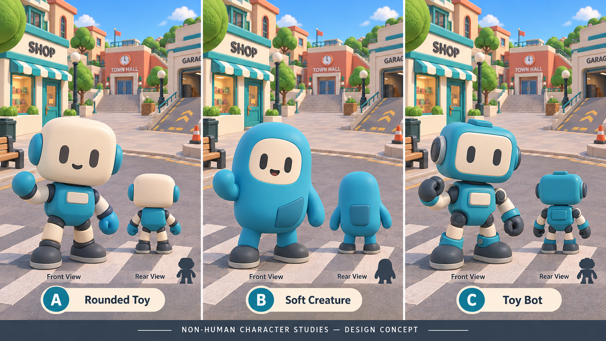
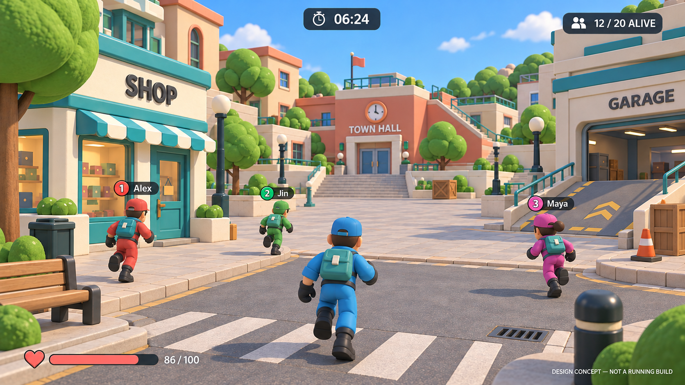
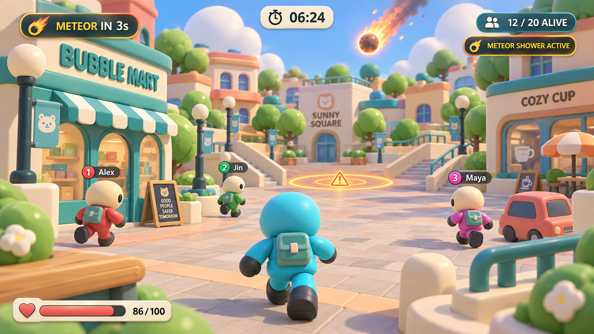

# Selected Phase 7 design references

These are the generated concept images selected during the [design conversation](https://ampcode.com/threads/T-01a1330a-6b68-7301-94df-dc0b5a0abfb9), preserved as source references, not shipped textures or evidence that the game renders identically.

| Reference | Use | Do not copy |
| --- | --- | --- |
| [Soft Creature selection](soft-creature-selection.png) | **B**, the middle option: broad continuous non-human body, oval cream face, short rounded limbs, rubber feet | A/C variants; human proportions; enlarging gameplay colliders |
| [Town materials](town-material-direction.png) | Matte architecture, restrained lighting, consistent cream/teal trim, roads, detailed house/school/shop/interiors | Human characters; cinematic lighting; obstructing playable routes |
| [Soft Vinyl UI](soft-vinyl-ui-direction.png) | Cream panels, teal actions, compact dark HUD, outfit cards with real previews, deliberate spacing | Glowing meteor; invented weapons, stats or progression; exact concept text |
| [Owner's rounded town/camera reference](rounded-town-camera-reference.png) | Current priority: genuinely curved trim/corners/props, continuous striped awning, rounded greenery and detailed rooftops/streets | Tiny chamfers masquerading as rounded forms; inflated paving; flat-roof railings intersecting pitched roofs; concept screenshots as proof |

## Provenance and implementation

AI-generated concepts made in this conversation with Painter, downloaded from the conversation attachments using `amp files get`. No third-party geometry or stock textures were imported. No CC0 claim is made for these images. Reference files are excluded from both export presets by `assets/references/*`.

Runtime character geometry is project-authored by `tools/asset_generation/generate_assets.gd`, generator7 seed297. Runtime town/harbor detail is authored in `game/main.gd`; controls use `game/ui/ui_tokens.gd`. The asset manifest records the distinction between concepts and runtime assets. Runtime captures were reviewed on Linux Compatibility/llvmpipe; native Windows/GPU and the user's aesthetic acceptance remain unverified.

The owner's exact2026-10-14 attachment is preserved as `rounded-town-camera-reference.png`.
It supersedes the previous tiny-bevel interpretation. Its three camera views are generated
concepts, not actual game captures. The source screenshot was supplied by the owner;
no new external model package was sourced. Terrain/layout and lighting still differ
from the reference; source implementation is not a claim of human aesthetic approval.
